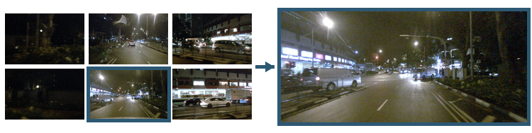

# V-ADSD

Code for V-ADSD: Visual Attacks Can Reduce Speculative Decoding Efficiency in
Driving VLMs. This repository studies a digital availability
attack against a DriveLM-adapted vision-language model accelerated by ViSpec
speculative decoding. The attack changes the six processed camera views to
reduce draft–target agreement while constraining the target model's response.



## Paper result

The frozen test set contains 51 long-form planning questions from 21 nuScenes
scenes. Attack parameters were selected on a separate 10-scene calibration
set. Every table row used one NVIDIA A100 40 GB GPU, FP16 evaluation, greedy
decoding, and the same 64-token output cap.

| Condition | Tokens / target call | Change | E2E latency (s) | Change | Target F1 | Clean target match | SD / target match |
|---|---:|---:|---:|---:|---:|---:|---:|
| Clean | 4.418 | — | 1.413 | — | .745 | — | 51/51 |
| Random sign | 4.541 | +2.8% | 1.499 | +6.1% | .744 | 50/51 | 51/51 |
| FGSM, λ=1 | 4.667 | +5.6% | 1.503 | +6.4% | .737 | 50/51 | 51/51 |
| PGD, λ=0 | 2.327 | −47.3% | 1.688 | +19.5% | .580 | 28/51 | 50/51 |
| **PGD, λ=1** | **2.563** | **−42.0%** | **1.669** | **+18.2%** | **.741** | **50/51** | **51/51** |
| **PGD, λ=4** | **2.644** | **−40.2%** | **1.667** | **+18.0%** | **.741** | **50/51** | **51/51** |

The primary λ=1 attack preserves all 51 driving actions. One response changes
wording in its explanation, so the stricter full-response match is 50/51.
Speculative and ordinary target decoding still produce identical token
sequences on all 51 attacked inputs.

Run the lightweight integrity check and regenerate the table with:

```bash
python scripts/validate_artifact.py
python scripts/render_table.py
```

## What is included

- the exact 10-question calibration and 51-question test manifests, with image
  paths relative to a nuScenes root;
- the target-only/ViSpec runner, PGD/FGSM optimizer, matched-random control,
  metric analysis, and target/draft adaptation code;
- two small patches against the pinned ViSpec source revision;
- the frozen protocol and aggregate values used in the paper table; and
- a parameterized Slurm launcher for reproducing clean and attack runs.

The repository does **not** contain nuScenes images, DriveLM annotations,
saved adversarial tensors, or the final runs' per-sample raw outputs. The
committed
`results/paper_results.json` is an aggregate evidence record transcribed from
six completed GPU runs; it is not a substitute for raw traces. Re-execution
creates new raw outputs under a user-selected large-artifact directory.

## Setup

Use Python 3.10 or 3.11 and a CUDA 12-capable PyTorch installation. The frozen
package snapshot is in `requirements.txt`; PyTorch's `+cu128` wheels may require
the PyTorch wheel index on a fresh machine.

```bash
git clone https://github.com/ulairii/V-ADSD.git
cd V-ADSD
bash scripts/setup_vispec.sh
python -m venv .venv
source .venv/bin/activate
pip install --upgrade pip
pip install --extra-index-url https://download.pytorch.org/whl/cu128 -r requirements.txt
```

Download or prepare these external resources separately:

1. nuScenes v1.0-trainval images;
2. public DriveLM v1.1 annotations, if rebuilding the splits; and
3. Qwen2.5-VL-7B-Instruct at revision
   `cc594898137f460bfe9f0759e9844b3ce807cfb5`, the base of the
   DriveLM-adapted target.

Set paths without copying large artifacts into this repository:

```bash
export NUSCENES_ROOT=/path/to/nuscenes
export TARGET_MODEL=/path/to/target
export DRAFT_MODEL=/path/to/draft
export VADSD_WORKDIR=/path/to/large-storage/V-ADSD
```

The target and draft training recipe is documented in
[`docs/REPRODUCIBILITY.md`](docs/REPRODUCIBILITY.md).

`NUSCENES_ROOT` may either contain `samples/` directly or be a bundle root
containing `data_full/nuscenes/samples/`.

## Reproduce the frozen evaluation

First obtain a clean paired rollout, which also provides the target tokens used
by the attack objective:

```bash
python scripts/eval/run_drivelm_vispec.py \
  --manifest manifests/test.jsonl \
  --image-root "$NUSCENES_ROOT" \
  --output "$VADSD_WORKDIR/clean/results.json" \
  --summary-output "$VADSD_WORKDIR/clean/summary.json" \
  --base-model "$TARGET_MODEL" \
  --spec-model "$DRAFT_MODEL" \
  --mode paired --max-new-tokens 64 \
  --max-visual-tokens-per-image 256 \
  --torch-dtype float16 --seed 0 --require-token-parity
```

Then generate the primary response-preserving perturbations and evaluate them:

```bash
python scripts/eval/optimize_visual_attack.py \
  --manifest manifests/test.jsonl --image-root "$NUSCENES_ROOT" \
  --clean-results "$VADSD_WORKDIR/clean/results.json" \
  --output-dir "$VADSD_WORKDIR/pgd-lambda1/tensors" \
  --progress-json "$VADSD_WORKDIR/pgd-lambda1/attack-progress.json" \
  --base-model "$TARGET_MODEL" --spec-model "$DRAFT_MODEL" \
  --method pgd --objective draft_ce --epsilon 32 --steps 20 --step-size 2 \
  --preservation-weight 1 --preservation-objective mean_ce \
  --attack-start 11 --attack-tokens 24 --preservation-tokens 13 \
  --max-visual-tokens-per-image 256 --torch-dtype bfloat16 --seed 0

python scripts/eval/run_drivelm_vispec.py \
  --manifest manifests/test.jsonl --image-root "$NUSCENES_ROOT" \
  --output "$VADSD_WORKDIR/pgd-lambda1/results.json" \
  --summary-output "$VADSD_WORKDIR/pgd-lambda1/summary.json" \
  --base-model "$TARGET_MODEL" --spec-model "$DRAFT_MODEL" \
  --mode paired --max-new-tokens 64 --max-visual-tokens-per-image 256 \
  --torch-dtype float16 --seed 0 --require-token-parity \
  --adversarial-input-dir "$VADSD_WORKDIR/pgd-lambda1/tensors"
```

On a Slurm cluster, `slurm/run_paper_condition.sbatch` keeps code separate from
models, caches, tensors, and raw runs in the configured work directory. See the
launcher header for submission examples.

## Scope

V-ADSD is a white-box, per-input, digital attack evaluated on one model pair in
open-loop visual question answering. Its RGB-equivalent L∞ budget is 32/255 and
may be visible. The current result demonstrates a decoding-efficiency risk; it
does not demonstrate a physical attack, a closed-loop driving failure, or that
speculative decoding becomes slower than ordinary target-only decoding.

## License and attribution

Code is released under Apache-2.0. ViSpec remains under its upstream license.
The example images are derived from nuScenes/DriveLM data and remain subject to
their respective dataset terms; see `NOTICE`.
